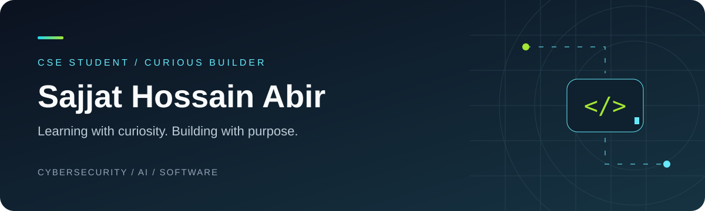

### Computer Science Student · Cybersecurity Learner · Project Builder

Exploring defensive security and turning practical ideas into websites and software.

---

### A little about me

I'm **Sajjat Hossain Abir**, a computer science student building my foundation in cybersecurity and security operations. I enjoy understanding system behavior, investigating suspicious activity, and creating tools that make everyday work easier.

**Current interests** · Defensive security · Python automation · Web development

### Selected projects

| Project | What it does | Explore |
| :--- | :--- | :--- |
| **Portfolio website** | A responsive personal website with project filters, a theme switch, and contact links. Built with HTML, CSS, and JavaScript. | [Website source & setup](projects/portfolio-website/README.md) |
| **Focus Desk** | A Python desktop task app: add tasks, mark them complete, filter your list, and save it locally. | [App source & setup](projects/focus-desk/README.md) |
| **Security log analyzer** | An educational Python command-line tool that reports repeated failed SSH passwords in offline logs. | [Project guide](projects/security-log-analyzer/README.md) |

The website and desktop app are source projects you can run locally. The log analyzer uses synthetic sample logs for learning.

### Tools I'm exploring

### What's next

- **Home SOC lab** — event collection, investigation notes, and a documented lab setup.
- **Detection notebook** — rules, sample events, false positives, and limitations.

These are planned learning projects.

---

**Let's connect** · [Email](mailto:abirsajjathossain2@gmail.com) · [GitHub](https://github.com/SajjatAbir) · [Support my learning](https://ko-fi.com/sajjathossainabir)

Learning. Building. Documenting the journey.

